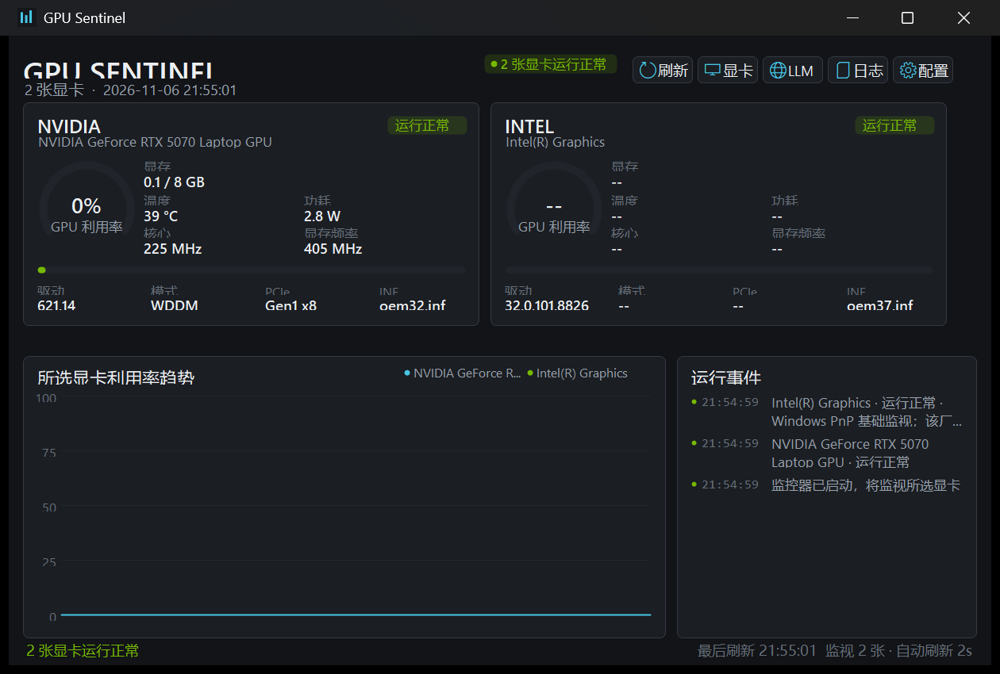

# GPU Sentinel for Windows x64

[](LICENSE)
[](#requirements)
[](#requirements)

Windows x64 多显卡实时监视器，可自动发现并选择 Intel 核显、NVIDIA 独显、Tesla 计算卡和 AMD 等 PCI 显示适配器。



## 功能

- 自动枚举所有 PCI 显示适配器
- 通过顶部“显卡”按钮自主选择同时监视的设备
- 支持一张、两张或更多显卡的动态卡牌布局
- NVIDIA 使用 `nvidia-smi` 显示利用率、显存、温度、功耗、时钟、PCIe 和 WDDM/TCC
- Intel、AMD 等设备显示 Windows PnP 状态、驱动版本、INF、错误代码和问题描述
- GPU 利用率趋势图
- 设备异常、温度阈值和驱动事件提醒
- 本地 CSV 遥测
- 系统托盘常驻
- 设备选择保存在本机，不向网络发送遥测

## 已验证设备

- Intel Graphics + NVIDIA GeForce RTX 5070 Laptop 同时监视
- Tesla V100-SXM2-16GB 在 581.15 双卡环境中监视
- 可单独选择 Intel 核显
- AMD 使用相同的 Windows PnP 基础监视路径，但尚未在 AMD 实机上验证

## 下载

从 Releases 下载 x64 压缩包：

```text
https://github.com/zzs4057/gpu-sentinel-win-x64/releases/latest
```

解压到任意目录后运行：

```text
monitor\V100Monitor.exe
```

创建桌面快捷方式：

```text
monitor\create-shortcut.cmd
```

打开设备选择窗口：

```text
monitor\V100Monitor.exe --select-devices
```

## 选择显卡

点击顶部“显卡”按钮，在列表中勾选需要监视的设备：

- `[NVIDIA]`：完整 NVIDIA 遥测
- `[Intel]`：核显基础监视
- `[AMD]`：AMD/PCI 显示适配器基础监视
- `[Other]`：其它 PCI 显示设备的基础监视

未勾选的设备不会进入监视卡片、趋势图和 CSV 日志。

## 配置文件

程序首次保存设备选择时会生成：

```text
monitor\V100Monitor.ini
```

该文件包含本机 PNP 设备 ID，因此被 `.gitignore` 排除，不应提交到 GitHub。

模板文件：

```text
monitor\V100Monitor.example.ini
```

## 数据来源

- `nvidia-smi.exe`
- `Win32_PnPEntity`
- `Win32_PnPSignedDriver`
- Windows System 事件日志

程序不复制 NVIDIA DLL，不上传遥测数据，也不包含模型权重或 GPU UUID 数据库。

## 构建

要求 Windows 10/11 x64 和 .NET Framework 4.8。

```powershell
.\monitor\build.ps1
```

输出：

```text
monitor\V100Monitor.exe
```

## 隐私与脱敏

公开仓库不包含：

- 用户名、主机名或账号
- GPU UUID、序列号或完整设备实例 ID
- 完整本地路径
- IP 地址、MAC 地址或访问令牌
- 运行时生成的日志和 CSV

## 相关仓库

RTX 5070 + Tesla V100 驱动共存和 llama.cpp 方案：

```text
https://github.com/zzs4057/v100-rtx5070-windows-dualgpu
```

## 许可证

MIT License。见 [LICENSE](LICENSE) 和 [THIRD_PARTY_NOTICES.md](THIRD_PARTY_NOTICES.md)。

NVIDIA、GeForce、Tesla、Intel、AMD 和 Windows 是其各自所有者的商标。本项目与这些公司没有隶属关系。
